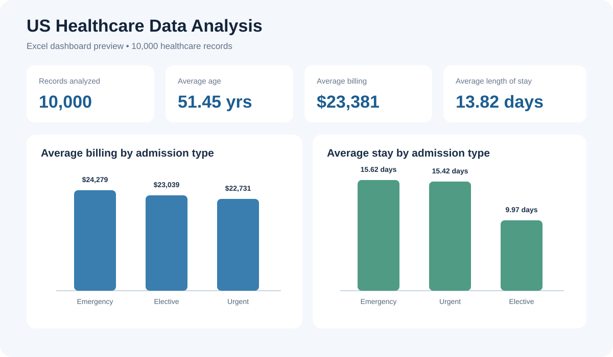
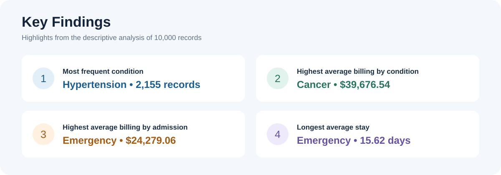

# US Healthcare Data Analysis (Excel)

## Project overview
An exploratory analysis of a 10,000-record US healthcare dataset using Microsoft Excel. The project examines patient demographics, medical conditions, admission types, length of stay, and billing patterns.

> **Data privacy:** Publish the workbook only if the data is synthetic or fully anonymized and you are authorized to share it. Never upload patient names, contact details, IDs, or other identifiable information.

## Business questions
- What does the patient age and gender distribution look like?
- Which medical conditions occur most frequently?
- How do average billing amounts vary by admission type and condition?
- How does length of stay differ across admission types?

## Tools and skills
- Microsoft Excel
- Data cleaning and preparation
- PivotTables and PivotCharts
- KPI reporting and dashboard design
- Exploratory data analysis and insight communication

## Dashboard preview\n\n\n\n## Key insights graphic\n\n\n\n## KPI snapshot
| Metric | Result |
|---|---:|
| Records analyzed | 10,000 |
| Average patient age | 51.45 years |
| Average billing amount | $23,381.11 |
| Average length of stay | 13.82 days |
| Female records | 5,075 |
| Male records | 4,925 |

## Key findings
- Hypertension was the most frequent condition, with 2,155 records.
- Cancer had the highest average billing amount among the listed conditions, at approximately $39,676.54.
- Emergency admissions had the highest average billing amount by admission type, approximately $24,279.06.
- Average stay was longest for Emergency admissions (15.62 days), followed by Urgent (15.42) and Elective (9.97).

## Analysis workflow
1. Reviewed the dataset structure and fields.
2. Checked for missing values, duplicates, and inconsistent entries.
3. Prepared fields for analysis.
4. Used PivotTables and charts to summarize demographic, condition, billing, and stay patterns.
5. Built a dashboard to communicate KPIs and findings.

## Business relevance
This project demonstrates how healthcare operations data can be summarized to support exploratory monitoring of billing patterns, admission mix, and length of stay. These are descriptive findings only; they do not establish clinical or causal relationships.

## Repository structure
```
US-Healthcare-Data-Analysis/
├── README.md
└── assets/
    ├── healthcare_dashboard.png
    └── key_insights.png
```

## About me
I am transitioning into Data Analytics after four years of experience in AC compressor manufacturing. I am developing my skills in Excel, Power BI, SQL, and Python and building practical projects to demonstrate my analytical and problem-solving abilities.

**Author:** Ritik Khatri  
**GitHub:** https://github.com/khatri-ritik
